# Mapa do programa — Editor de Impressão

Para a gerente guiar o Samuel nas sessões de teste, uma instrução por vez, e para ele ensinar o Kaique.
Feito em 23/10/2026 pelo verificador, com a **janela de verdade** (ramo `fase-1` em `5535187`, já com a Fase 2),
aberta fora da tela do Samuel, com uma pasta de dados separada (nada dos livros, receitas ou configurações dele
foi tocado). Livro do percurso: **"La vida eterna y La profundidad del alma.pdf"** (180 folhas, o mesmo da sessão 0),
copiado para a pasta de trabalho; o original não foi aberto pelo programa.

Como foi feito: os cliques nos botões que o Samuel clica (caixinhas, "Conferir", ícones das duas colunas, "está
certo", "próxima dúvida", "Confirmar e processar", "Processar", partes das Configurações) foram cliques do Windows;
a barra de espaço e o Tab foram teclas do Windows. Os prints foram tirados da janela pelo Windows. Os nomes entre aspas
são os que aparecem na tela, copiados da janela (não da memória do código). A janela tinha 1536 x 800 pontos, o
tamanho da tela do Samuel com a barra de tarefas.

Cada parte tem: **o print legendado**, **o nome na tela**, **onde fica**, **o que faz** e, separado, **pontos
confusos**. As respostas às três perguntas (a, b, c) estão logo abaixo, antes do mapa.

---

## Respostas rápidas

### (a) Onde está o "modo automático" e como chegar nele

**Não existe um botão que "rode o automático".** O que o programa faz sozinho é escolhido na tela "Marque o que você
quer fazer" e começa quando se clica **"Conferir"**: ele olha o livro inteiro ("Olhando o livro...", uns 30 a 45
segundos neste livro) e já decide sozinho onde dividir, quanto girar, onde cortar e qual filtro usar. Depois disso,
o Kaique só confere as páginas com dúvida e clica "Confirmar e processar". Se ninguém mexer em nada, sai como o
programa decidiu.

Há três lugares com a palavra "automático", e nenhum deles roda nada:

1. **"Rodar o automático..."** — botão da segunda linha do livro aberto (tela inicial > um clique no cartão do livro).
   Ele só leva para a tela "Marque o que você quer fazer" deste livro. Caminho: tela inicial → clique no cartão → "Rodar
   o automático..." → marcar as caixinhas → "Conferir".
2. **Painel "Automático"** — 2º ícone da coluna da direita (logo abaixo do triângulo do "Para revisar"), na tela de conferir. Só **mostra** quais etapas estão
   ligadas neste livro (Dividir, Endireitar, Cortar, Limpar, Montar cadernos) e tem o botão "Voltar para as opções".
   Não tem botão de rodar e as etapas não são de clicar.
3. **"Jeito do preto e branco: Automático"** — dentro de "Mais ajustes", no painel Filtro da página. É outra coisa
   (a conta do Preto e branco).

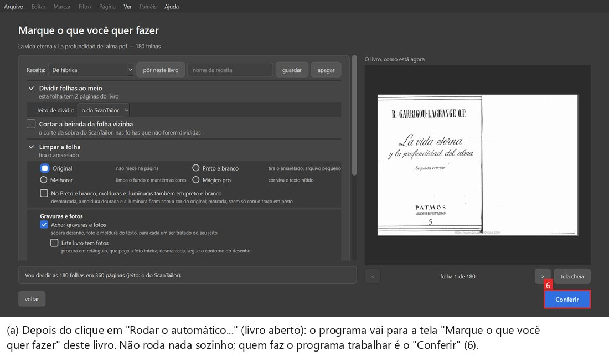

**Cuidado achado no caminho (defeito já registrado em 29/09 na Lista de bugs, ainda aberto):** num livro que já
passou pelo "Conferir" uma vez, voltar pelo "Rodar o automático...", marcar mais caixinhas (ex.: Endireitar e Cortar)
e clicar "Conferir" **não vale**: a frase de baixo diz que vai endireitar e cortar, mas a tela de conferir volta igual,
sem as ferramentas novas. Só muda se o número de páginas mudar (ex.: Dividir). Para o teste, usar sempre um livro
novo ou "começar de novo" no menu do cartão.

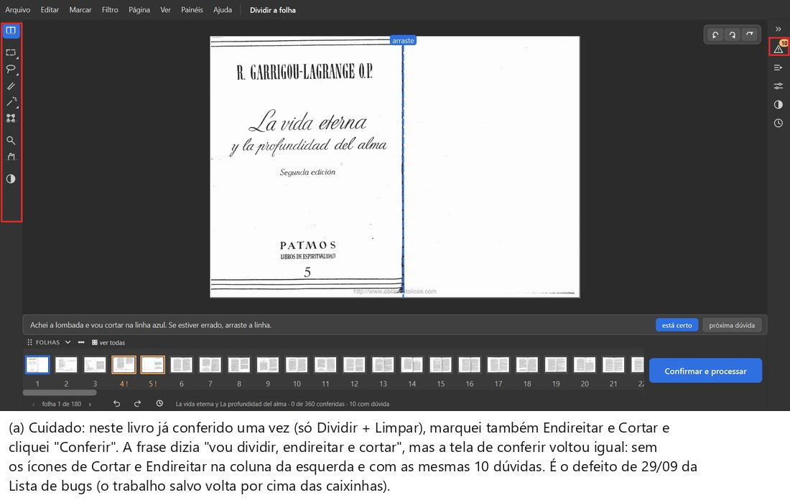

### (b) Achado 0-4: por que só dois ícones na coluna da esquerda

A coluna da esquerda só mostra as ferramentas das etapas marcadas. Reproduzi cinco combinações, cada uma num livro
novo:

| Caixinhas marcadas | Ícones na coluna da esquerda | Páginas com dúvida |
|---|---|---|
| Dividir + Limpar (Cortar e Endireitar desmarcadas) | 9: Dividir, Retângulo, Laço, Pincel, Varinha, Mover a área, Zoom, Mão, Os quatro filtros | 10 |
| Dividir + Cortar | 2: Dividir, Cortar | — |
| **Dividir + Endireitar** | **2: Dividir, Endireitar** | **58** |
| só Dividir | 1: Dividir | — |
| Dividir + Limpar + Endireitar + Cortar | 11 (todas) | 56 |

O print do Samuel tem **dois ícones: a folha aberta (Dividir) e um retângulo inclinado (Endireitar)**, e o rodapé
dele diz **"58 com dúvida"**. As duas coisas batem exatamente com **Dividir + Endireitar, com "Limpar a folha" e
"Cortar as bordas" desmarcadas**. Com Dividir + Limpar marcados apareceriam 9 ícones, não 2.

Provável causa: de fábrica, "Limpar a folha", "Endireitar" e "Cortar as bordas" **já vêm marcadas**, e caixinha
marcada aparece só como um tique, sem quadrado (a desmarcada tem quadrado vazio). Quem clica em "Limpar a folha"
achando que está marcando, na verdade desmarca. Sem "Limpar a folha", somem todas as ferramentas de marcar, o Zoom,
a Mão e "Os quatro filtros". E os painéis (Para revisar, Automático, Propriedades, Filtro, Histórico) não sumiram: eles
moram na coluna da **direita** e começam fechados.

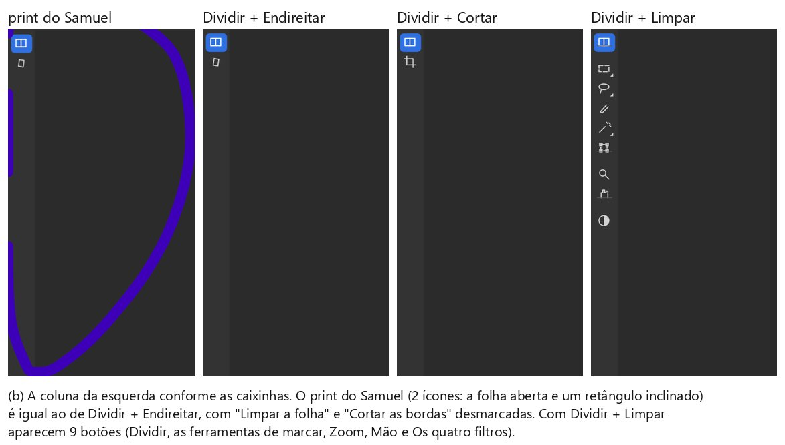

### (c) Achado 0-5: a folha 5 "jogada para cima"

**O deslocamento já está no PDF.** A página 5, aberta direto do arquivo (sem o programa), já tem o texto da direita
lá em cima, com "PRIMERA PARTE" cortado no alto, e a página da esquerda quase vazia. A tela "Dividir a folha" mostra
a folha como ela é (só girada de pé). Não foi o programa.

Uma coisa a mais, vista nesta folha: o programa pôs a linha azul de dividir quase na beirada esquerda e a faixa
avisa "Não tenho certeza de onde cortar. Confira a linha." (a miniatura 5 tem o "!" laranja). No print do Samuel a
linha estava no meio.

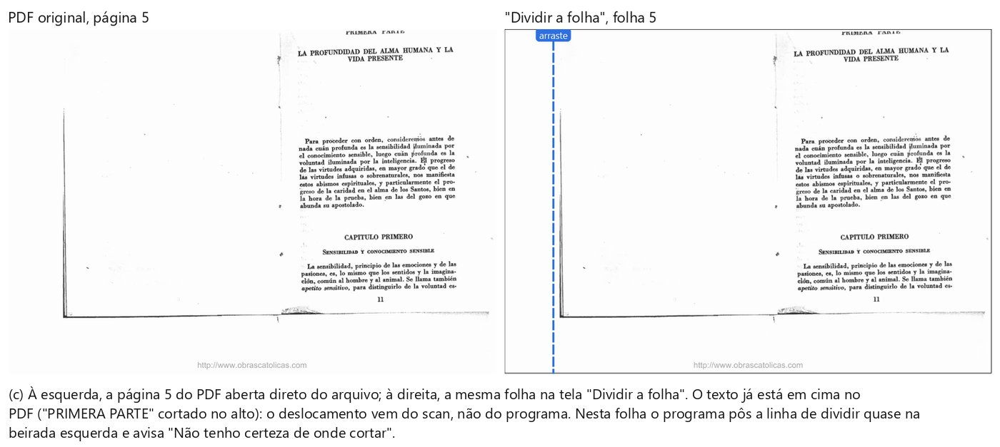

---

## 1. Tela inicial ("Seus livros")

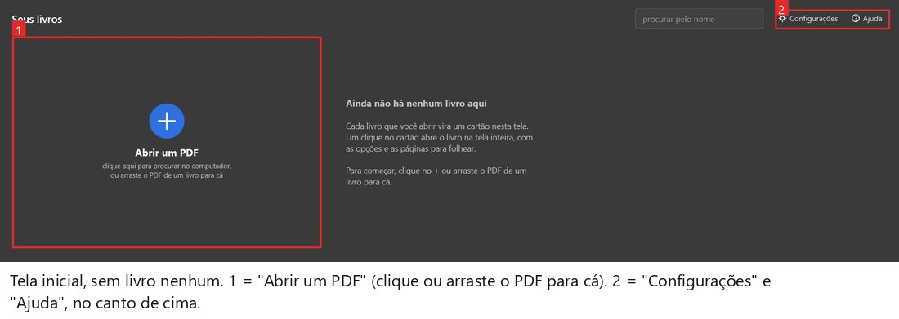

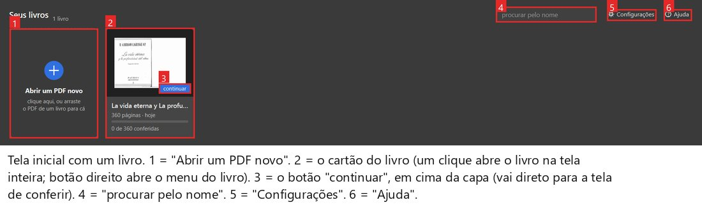

| Nome na tela | Onde fica | O que faz |
|---|---|---|
| "Abrir um PDF" / "Abrir um PDF novo" | primeiro quadro da grade, com o "+" azul | Clique: abre a janela do Windows para escolher o PDF. Também dá para arrastar o PDF para qualquer lugar da tela. Abrir leva para "Marque o que você quer fazer". |
| cartão do livro | ao lado do "+": capa, nome, "360 páginas · hoje", "0 de 360 conferidas" | Um clique: abre o livro na tela inteira. Duplo clique: continua o trabalho. Botão direito: o menu do livro. |
| "continuar" | botão azul pequeno em cima da capa, no canto | Vai direto para a tela de conferir, onde parou. |
| "procurar pelo nome" | campo no alto, à direita | Filtra os cartões pelo nome. |
| "Configurações" | alto, à direita | Abre as Configurações (parte 5). |
| "Ajuda" | alto, à direita | Abre a "Lista de atalhos" (F1). |

Menu do botão direito do cartão (o mesmo do "Mais..."): "continuar", "começar de novo", "renomear", "abrir a pasta de
saída" (cinza até o livro gerar um PDF), "remover da lista".

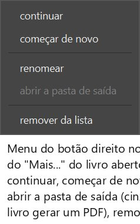

### 1.1 O livro aberto (um clique no cartão)

| Nome na tela | Onde fica | O que faz |
|---|---|---|
| "Voltar para os livros   Esc" | 1ª linha, à esquerda | Volta aos cartões. |
| "Mais..." | 1ª linha, à direita | O mesmo menu do botão direito do cartão. |
| "Continuar" (azul) | 2ª linha, 1º botão | Abre a tela de conferir deste livro. |
| "Rodar o automático..." | 2ª linha, 2º botão | Leva para "Marque o que você quer fazer" deste livro. **Não roda nada.** |
| "Ver todas as páginas" | 2ª linha, 3º botão | A grade das folhas do PDF. |
| "Confirmar e processar..." | 2ª linha, 4º botão | Abre o trabalho e já pede a confirmação para gerar o PDF. |
| "Onde está: ..." | 2ª linha, à direita | O caminho do PDF no computador. |
| "Uma página", "Duas lado a lado", "Rolar sem parar", "Caber a página", "Caber a altura", "Caber a largura", "Tamanho real" | barra de baixo, no meio | Jeitos de ver as páginas. |
| "página 1 de 180 · ir para", "‹" "›" | canto de baixo, à direita | Andar pelas folhas. |

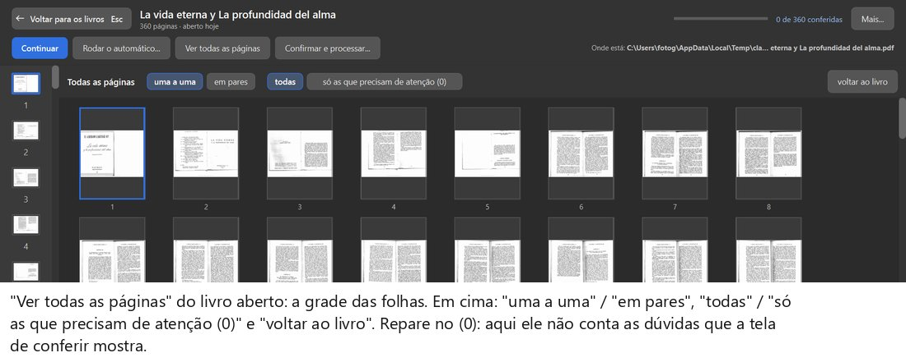

**Pontos confusos — tela inicial e livro aberto**

- **"Rodar o automático..." não roda nada**: só abre a tela das caixinhas. O nome promete uma coisa que não acontece.
- O livro aberto diz **"360 páginas"** em cima e **"página 1 de 180"** embaixo: uma conta páginas do livro pronto, a
  outra conta folhas do PDF.
- Em "Ver todas as páginas" do livro aberto, o botão diz **"só as que precisam de atenção (0)"**, enquanto a tela de
  conferir do mesmo livro diz 56 com dúvida.
- O nome comprido do livro é cortado no cartão ("La vida eterna y La profu...").

---

## 2. "Marque o que você quer fazer"

Aparece ao abrir um PDF novo, pelo "Rodar o automático..." e por Arquivo > "Voltar para as opções".

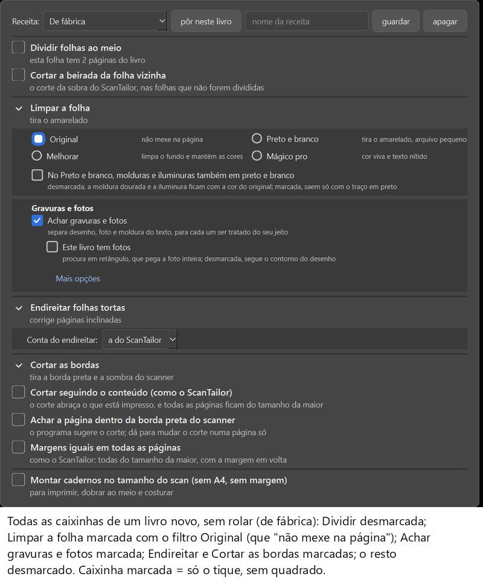

| Nome na tela | De fábrica | O que faz | O que liga/desliga depois |
|---|---|---|---|
| "Receita:" com "De fábrica", "pôr neste livro", "nome da receita", "guardar", "apagar" | De fábrica | Guarda as caixinhas desta tela com um nome e as põe de volta noutro livro. | Nada na tela de conferir. Não é automático. |
| "Dividir folhas ao meio" | desmarcada | Divide cada folha em duas páginas. Marcada, abre "Jeito de dividir:" (o do ScanTailor / o do Editor). | Liga o 1º ícone da esquerda, "Dividir a folha". |
| "Cortar a beirada da folha vizinha" | desmarcada | Corta a sobra da folha ao lado, nas folhas que não forem divididas. | — |
| "Limpar a folha" | **marcada** | Liga os filtros. Embaixo: Original (de fábrica, "não mexe na página"), Preto e branco, Melhorar, Mágico pro; "No Preto e branco, molduras e iluminuras também em preto e branco"; "Gravuras e fotos". | Liga as ferramentas de marcar (Retângulo, Laço, Pincel, Varinha, Mover a área), o Zoom, a Mão e "Os quatro filtros". **Desmarcada, todas somem.** |
| "Achar gravuras e fotos", "Este livro tem fotos", "Mais opções" | marcada / desmarcada | Procura desenhos e fotos para tratar à parte. "Mais opções": Sensibilidade, "Procurar também imagens claras", "Igualar a luz da página antes". | Só aparece com "Limpar a folha". |
| "Endireitar folhas tortas" | **marcada** | Endireita páginas inclinadas. Abre "Conta do endireitar:" (a do ScanTailor / a do Editor). | Liga o 3º ícone, "Endireitar". |
| "Cortar as bordas" | **marcada** | Tira a borda preta e a sombra do scanner. | Liga o 2º ícone, "Cortar as bordas". |
| "Cortar seguindo o conteúdo (como o ScanTailor)" | desmarcada | O corte abraça o que está impresso. | — |
| "Achar a página dentro da borda preta do scanner" | desmarcada | Abre "Cortar:" (até a moldura / só o preto) e (cortar fora / pintar de branco). | — |
| "Margens iguais em todas as páginas" | desmarcada | Abre as quatro margens e o alinhamento. | — |
| "Montar cadernos no tamanho do scan (sem A4, sem margem)" | desmarcada | Abre "páginas por caderno". | Muda a tela "Ficou pronto!". |
| frase de baixo (ex.: "Vou endireitar as tortas e cortar as bordas.") | faixa embaixo das caixinhas | Diz o que vai ser feito. | — |
| "O livro, como está agora", "‹ folha 1 de 180 ›", "tela cheia" | coluna da direita | Folhear o PDF antes de decidir. | — |
| "voltar" / "Conferir" | rodapé | "Conferir" faz o programa olhar o livro e decidir tudo sozinho, e abre a tela de conferir. | — |

Com o **Preto e branco** escolhido aparecem mais três: "Só as letras", "Escurecer sozinho a força do preto quando o
texto sair falhado" e "Limpar a sujeira:".

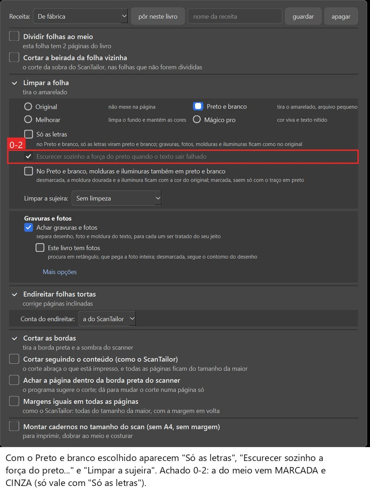

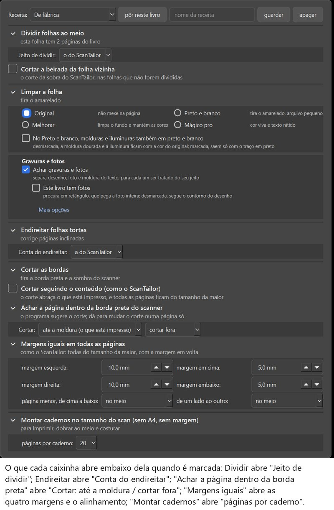

**Pontos confusos — "Marque o que você quer fazer"**

- **Marcada = só um tique, sem quadrado; desmarcada = quadrado vazio.** Parece que as marcadas "não têm caixa". É o
  jeito mais fácil de desmarcar "Limpar a folha" sem querer (achado 0-4).
- **"Limpar a folha" vem marcada com o filtro Original, que "não mexe na página".** O nome diz "tira o amarelado", mas
  de fábrica não tira nada. A frase de baixo nem menciona a limpeza.
- **A fila "Receita" (achado 0-1)** fica no topo, antes de tudo, com cinco peças e o nome "Receita"; não é automática
  e não explica que só guarda as caixinhas.
- **Achado 0-2:** "Escurecer sozinho a força do preto..." aparece **marcada e cinza** quando "Só as letras" está
  desmarcada. Parece ligada e travada; na verdade não vale enquanto "Só as letras" estiver desmarcada.
- As caixinhas não cabem na tela: "Margens iguais" e "Montar cadernos" só aparecem rolando.
- Os menus do alto aparecem nesta tela, mas **Editar, Marcar, Filtro, Página e Painéis ficam cinza**.
- Nomes com "ScanTailor" (Jeito de dividir: "o do ScanTailor", "Conta do endireitar: a do ScanTailor", "Cortar
  seguindo o conteúdo (como o ScanTailor)") não dizem nada ao Kaique.
- Mudar caixinhas num livro que já foi conferido e clicar "Conferir" não vale (ver a resposta (a)).

---

## 3. A tela de conferir

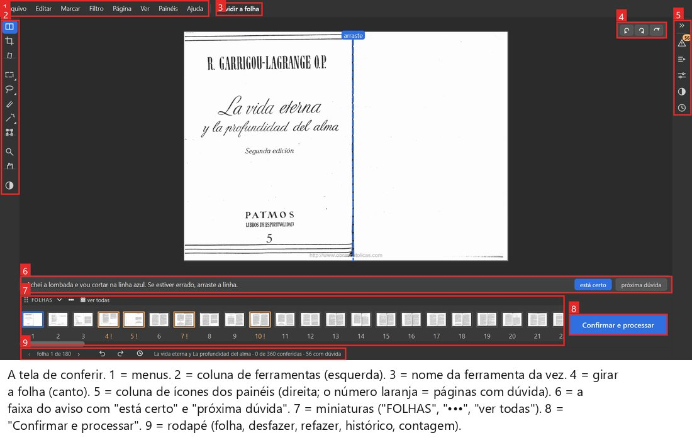

### 3.1 Menus do alto

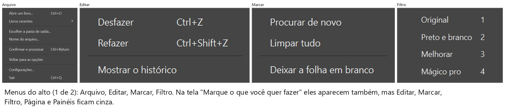

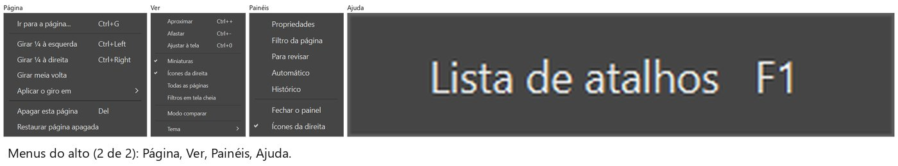

| Menu | Itens (como aparecem) |
|---|---|
| Arquivo | Abrir um livro... (Ctrl+O) · Livros recentes · Escolher a pasta de saída... · Nome do arquivo... · Confirmar e processar (Ctrl+Return) · Voltar para as opções · Configurações... · Sair (Ctrl+Q) |
| Editar | Desfazer (Ctrl+Z) · Refazer (Ctrl+Shift+Z) · Mostrar o histórico |
| Marcar | Procurar de novo · Limpar tudo · Deixar a folha em branco |
| Filtro | Original (1) · Preto e branco (2) · Melhorar (3) · Mágico pro (4) |
| Página | Ir para a página... (Ctrl+G) · Girar ¼ à esquerda (Ctrl+Left) · Girar ¼ à direita (Ctrl+Right) · Girar meia volta · Aplicar o giro em (só esta folha / todas as folhas / daqui em diante / só as pares / só as ímpares) · Apagar esta página (Del) · Restaurar página apagada |
| Ver | Aproximar (Ctrl++) · Afastar (Ctrl+-) · Ajustar à tela (Ctrl+0) · Miniaturas · Ícones da direita · Todas as páginas · Filtros em tela cheia · Modo comparar · Tema (Escuro / Cinza / Claro) |
| Painéis | Propriedades · Filtro da página · Para revisar · Automático · Histórico · Fechar o painel · Ícones da direita |
| Ajuda | Lista de atalhos (F1) |

Ao lado dos menus, em negrito, o **nome da ferramenta da vez** (ex.: "Dividir a folha").

### 3.2 Coluna de ferramentas (esquerda)

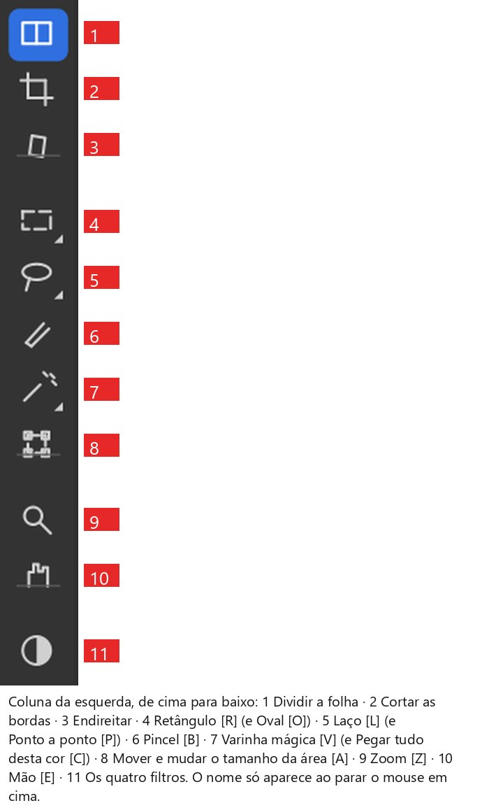

| Posição | Nome (balão do mouse) | O que faz | Aparece quando |
|---|---|---|---|
| 1º | Dividir a folha | "Arraste a linha azul para mudar onde a folha divide." | "Dividir folhas ao meio" marcada |
| 2º | Cortar as bordas | "Arraste o retângulo para mudar o corte da borda." | "Cortar as bordas" marcada |
| 3º | Endireitar | "Gire pela bolinha azul, ou desenhe a linha laranja em cima de uma linha do texto." | "Endireitar folhas tortas" marcada |
| 4º | Retângulo [R] (no mesmo botão: Oval [O]) | Marca uma área arrastando. | "Limpar a folha" marcada |
| 5º | Laço [L] (Ponto a ponto [P]) | Contorna uma área. | idem |
| 6º | Pincel [B] | Pinta por cima. | idem |
| 7º | Varinha mágica [V] (Pegar tudo desta cor [C]) | Pega a mancha de uma cor. | idem |
| 8º | Mover e mudar o tamanho da área [A] | Move/aumenta uma área marcada. | idem |
| 9º | Zoom [Z] | Aproxima (com Alt, afasta). | idem |
| 10º | Mão [E] | Anda pela página aproximada. | idem |
| 11º | Os quatro filtros | A mesma página nos quatro filtros; um clique escolhe. | "Limpar a folha" marcada (ou nenhuma outra etapa) |

Escolher Dividir, Cortar ou Endireitar **abre sozinho o painel Propriedades** (à direita), onde ficam os botões delas.

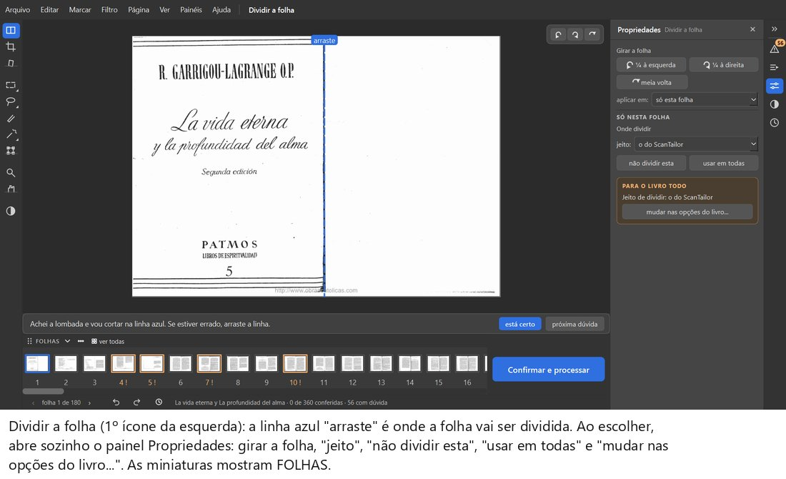

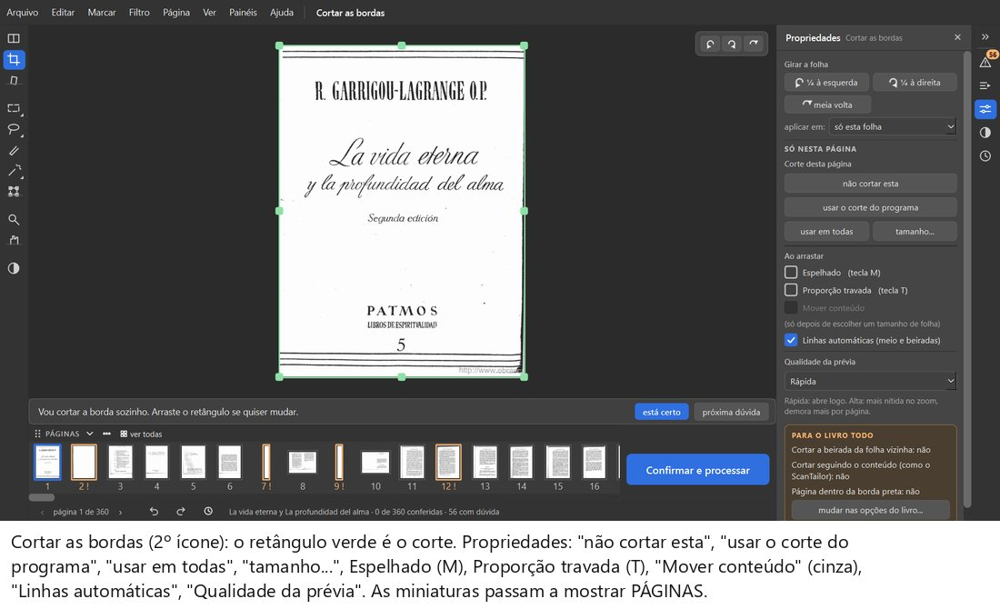

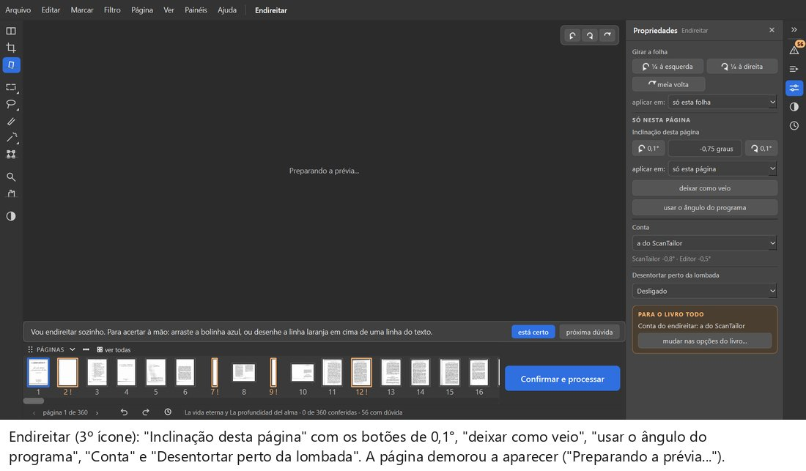

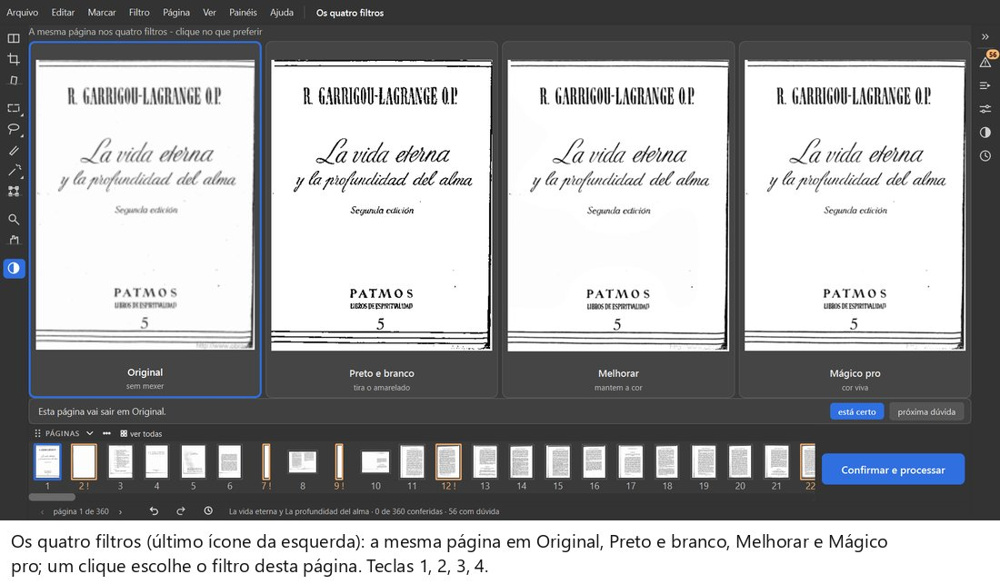

### 3.3 Coluna de ícones (direita) e os painéis

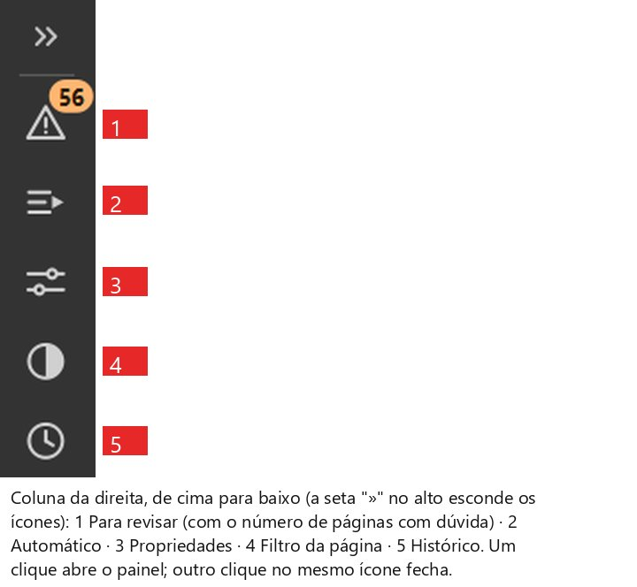

| Posição | Nome (balão) | O que tem dentro |
|---|---|---|
| no alto (sem número) | seta "»" ("esconder os ícones") | Esconde a coluna. |
| 1º | Para revisar (com o número laranja, ex.: 56) | A lista das páginas com dúvida, "Por página" ou "Por motivo"; clique numa leva até ela; "ver a lista...", "está bom em tudo". |
| 2º | Automático | Só mostra as etapas ligadas neste livro e a escolha de cada uma; botão "Voltar para as opções". |
| 3º | Propriedades | Muda conforme a ferramenta: girar a folha e "aplicar em"; os botões de Dividir/Cortar/Endireitar; com as de marcar, "Marcar como", "Marcação desta página", "Foto" e "Área". Embaixo, "PARA O LIVRO TODO" com "mudar nas opções do livro...". |
| 4º | Filtro da página | Os quatro filtros desta página (teclas 1 a 4), "Ajuste", "Só as letras", "Limpar a sujeira" e "Mais ajustes" (só fora do Original), "Só neste pedaço", "apagar página", "Aplicar em: só nesta / todas / daqui em diante"; o ícone de quadrado no título abre os filtros em tela cheia. |
| 5º | Histórico | "Desfazer", "Refazer" e a lista do que foi feito. |

Um clique no ícone abre o painel; outro clique no mesmo ícone fecha (testado com clique do Windows nos cinco). Todos
começam fechados ao abrir um livro.

### 3.4 A faixa do aviso: "está certo" e "próxima dúvida"

Fica logo embaixo da página. À esquerda, a frase do que o programa vai fazer nesta folha; à direita, "está certo"
(azul) e "próxima dúvida". Quando há dúvida, a faixa fica laranja e aparece um botão laranja com a sugestão (ex.:
"aceitar o corte").

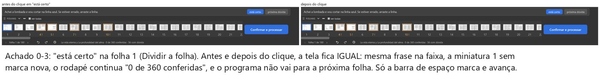

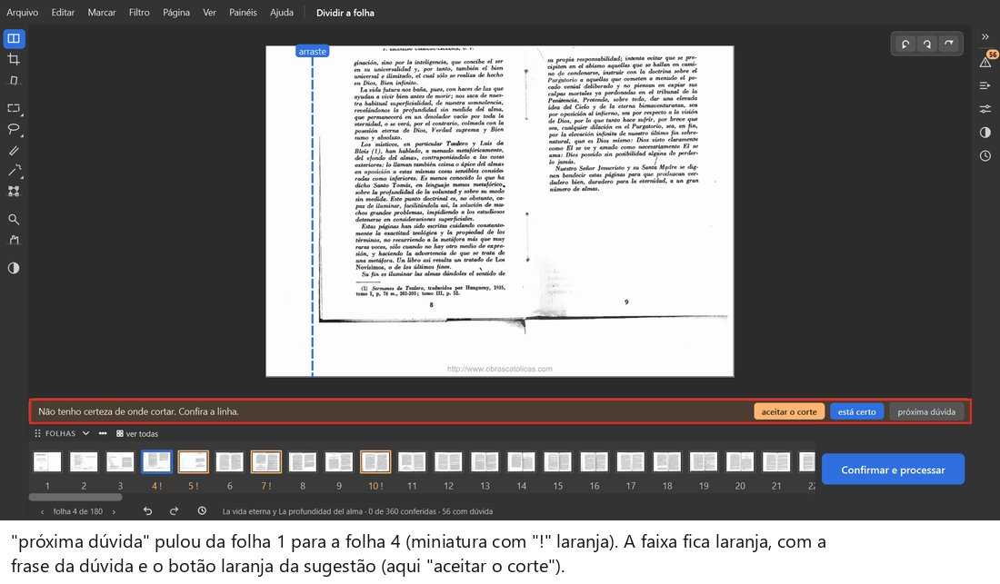

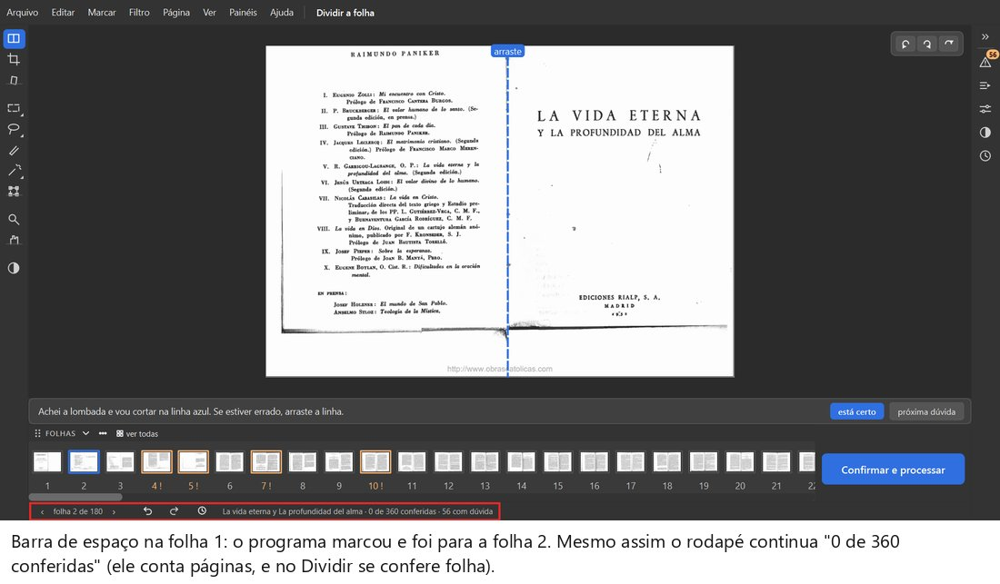

- **"está certo"** (clique do Windows, folha 1, Dividir a folha): **nada na tela mudou** — mesma frase, mesma folha,
  rodapé ainda "0 de 360 conferidas", miniatura sem marca nova. O balão do botão diz "Marca como conferida (a barra
  de espaço marca e já vai para a próxima)". Confirma o achado 0-3.
- **"próxima dúvida"**: foi da folha 1 para a folha 4 (a primeira com "!").
- **Barra de espaço**: marcou e foi para a folha 2. O rodapé continuou "0 de 360 conferidas".
- **Tab** ("Ir para a próxima dúvida"): no meu teste, com tecla do Windows, não andou (ficou na folha 2). Pode ser
  o lugar do foco; conferir na sessão com o Samuel.

### 3.5 Miniaturas, rodapé e "ver todas"

| Nome na tela | Onde fica | O que faz |
|---|---|---|
| "FOLHAS" (no Dividir) / "PÁGINAS" (nas outras ferramentas), com "⌄" | cabeçalho das miniaturas, à esquerda | A seta fecha as miniaturas. |
| "•••" | ao lado | Balão: "Mais opções das miniaturas" (não aberto no teste). |
| "ver todas" | ao lado | A grade de todas as páginas, com as de dúvida em laranja e o motivo; "voltar ao trabalho". |
| miniaturas com número; "!" laranja = dúvida | faixa de baixo | Um clique vai para a folha/página. |
| "Confirmar e processar" (azul, grande) | à direita das miniaturas | Ver parte 4. |
| "‹ folha 1 de 180 ›" | rodapé, à esquerda | Andar uma folha (setas do teclado também). |
| desfazer, refazer, relógio | rodapé | Desfazer (Ctrl+Z), Refazer (Ctrl+Shift+Z), abrir o Histórico. |
| "La vida eterna... · 0 de 360 conferidas · 56 com dúvida" | rodapé | Contagem do livro. |
| girar (três botões) | canto de cima, à direita da página | ¼ à esquerda, ¼ à direita, meia volta. |

### 3.6 Tela cheia e livro aberto

- **"Filtros em tela cheia"** (Ver > Filtros em tela cheia, ou o quadrado no título do painel Filtro da página): uma
  janela grande com os quatro filtros, "Comparar com o Original", "Aplicar em", "Fechar sem mudar" e "Usar <filtro>".
- **"tela cheia"** na tela das caixinhas: folhear o PDF grande.
- **O livro aberto** (tela inicial, um clique no cartão) é a tela cheia do livro, com as páginas como vieram no PDF.

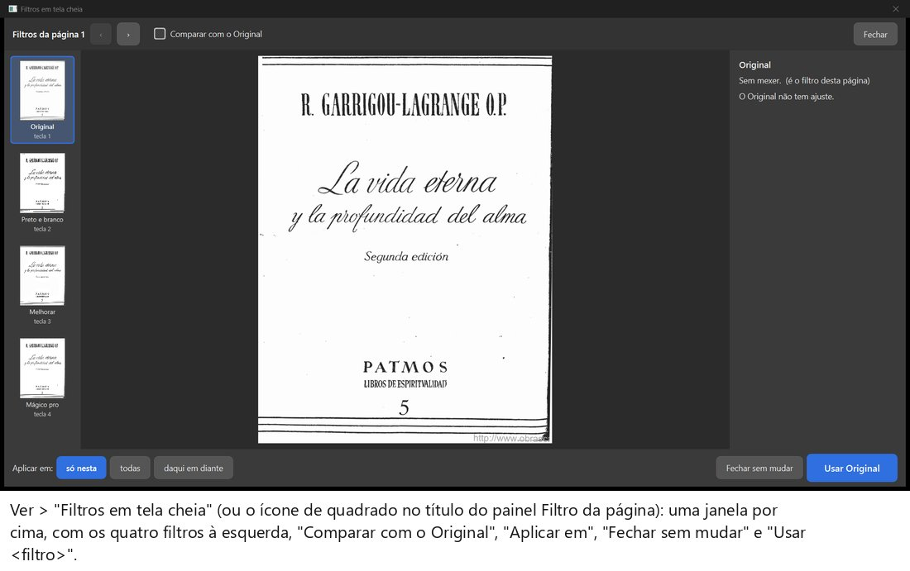

### 3.7 Atalhos de teclado importantes (todos trocáveis em Configurações > Atalhos de teclado)

| Tecla | O que faz |
|---|---|
| **Barra de espaço** | Marcar como certo e avançar |
| **Tab** | Ir para a próxima dúvida |
| Seta esquerda / direita | Página anterior / próxima |
| 1, 2, 3, 4 | Original, Preto e branco, Melhorar, Mágico pro |
| Del | Apagar esta página |
| Ctrl+Z / Ctrl+Shift+Z | Desfazer / Refazer |
| Ctrl+G | Ir para a página... |
| Ctrl+Left / Ctrl+Right | Girar ¼ à esquerda / à direita |
| Ctrl++ / Ctrl+- / Ctrl+0 | Aproximar / Afastar / Ajustar à tela |
| Ctrl+Return (Enter) | Confirmar e processar |
| Ctrl+O / Ctrl+Q | Abrir um livro / Sair |
| R, O, L, P, B, V, C, A, Z, E | Retângulo, Oval, Laço, Ponto a ponto, Pincel, Varinha, Pegar tudo desta cor, Mover a área, Zoom, Mão |
| M / T | Recorte: espelhado / proporção travada |
| F1 | Lista de atalhos |

**Pontos confusos — tela de conferir**

- **"está certo" não dá resposta nenhuma na tela** (achado 0-3): não avança, não muda a frase, não marca a miniatura,
  não muda a contagem.
- **A contagem do rodapé conta páginas (360), e no Dividir se confere folha (180).** "está certo" e a barra de espaço
  no Dividir não mudam "0 de 360 conferidas"; escolher um filtro numa página muda (vira "1 de 360").
- **Três números diferentes de dúvidas:** rodapé e "Para revisar" dizem **56**; a janela "Antes de processar" diz
  **"67 páginas ... (69 avisos)"**; o "Ver todas as páginas" do livro aberto diz **(0)**.
- **Folha e página se misturam:** no Dividir as miniaturas são "FOLHAS" ("folha 1 de 180"); nas outras ferramentas
  viram "PÁGINAS" ("página 1 de 360"), e o "Para revisar" fala sempre em página.
- **O nome da ferramenta só aparece com o mouse parado em cima** do ícone; a coluna da esquerda não tem palavras.
- **As ferramentas somem conforme as caixinhas** e nada na tela diz isso (achado 0-4). Os painéis ficam na direita,
  fechados, e também nada diz que estão lá.
- **"Os quatro filtros"** é um ícone da esquerda (meia lua) e também um painel da direita ("Filtro da página"),
  com o mesmo desenho; são duas portas para quase a mesma coisa.
- **"Automático"** só mostra as etapas; não roda nada (resposta a).
- **Esc não fecha o "ver todas"** (no teste, ficou na grade); só "voltar ao trabalho".
- O painel Filtro da página abriu com os quatro quadradinhos dos filtros **vazios (cinza)** na primeira vez; as
  miniaturas só apareceram depois.
- Endireitar: a página mostrou "Preparando a prévia..." por alguns segundos.
- Atalho escrito em inglês: "Ctrl+Return", "Ctrl+Left", "Ctrl+Right".
- Na "ver todas", as páginas 7 e 9 ("parece em branco") aparecem como uma tira branca estreita num quadro preto.

---

## 4. Processar, a tela "Ficou pronto!" e montar para imprimir

Caminho: "Confirmar e processar" (botão azul da tela de conferir, ou Ctrl+Enter) → se houver dúvidas, a janela
**"Antes de processar"** → a janela **"Confirmar e processar"** (onde salvar) → **"Processar"** → "Processando o
livro..." → **"Ficou pronto!"**.

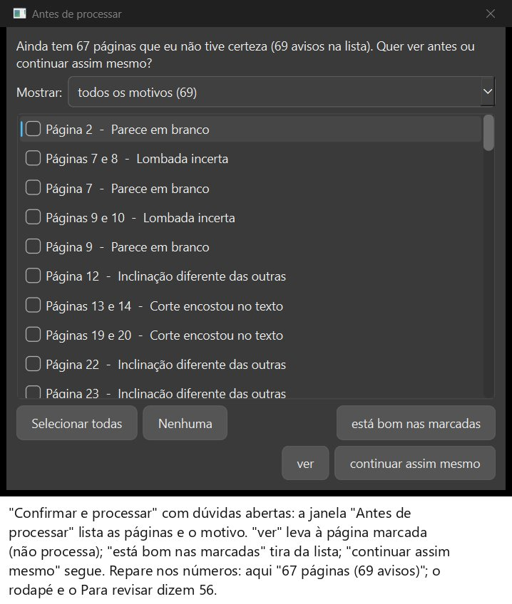

| Nome na tela | O que faz |
|---|---|
| "Mostrar:" (todos os motivos / um motivo) | Filtra a lista. |
| caixinha em cada linha, "Selecionar todas", "Nenhuma" | Escolhe linhas. |
| "está bom nas marcadas" | Tira as marcadas da lista (aceita como está). |
| "ver" | Fecha e vai para a página escolhida; não processa. |
| "continuar assim mesmo" | Segue para onde salvar. |

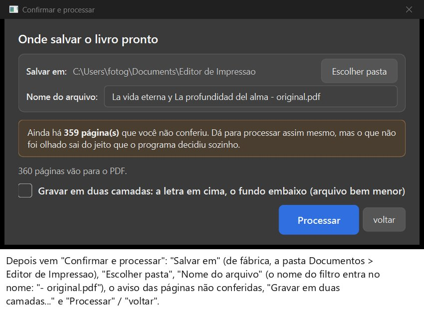

| Nome na tela | O que faz |
|---|---|
| "Salvar em:" e "Escolher pasta" | A pasta do PDF pronto (de fábrica, Documentos > Editor de Impressao). |
| "Nome do arquivo:" | De fábrica, o nome do livro com o filtro ("- original.pdf"). |
| aviso laranja | "Ainda há 359 página(s) que você não conferiu..." |
| "Gravar em duas camadas: a letra em cima, o fundo embaixo (arquivo bem menor)" | desmarcada de fábrica. |
| "Processar" / "voltar" | Começa / volta para a conferência. |

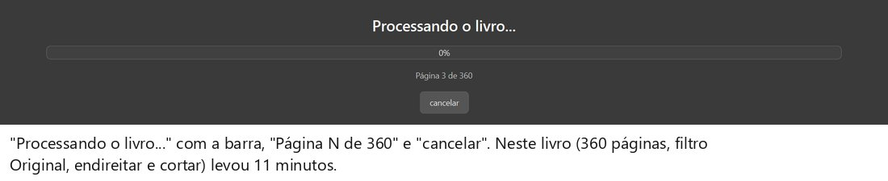

Neste livro, com Dividir + Endireitar + Cortar e filtro Original, processar levou **11 minutos** e o PDF saiu com
**360 páginas e 287,4 MB**.

| Nome na tela | O que faz |
|---|---|
| "abrir a pasta" | Abre a pasta do PDF no Windows (não testado: abriria na tela do Samuel). |
| **"imprimir agora"** | **Manda o PDF direto para a impressora padrão do Windows, sem janela de impressão.** (Não testado, de propósito.) |
| "montar para imprimir em A4 (com margens)..." | Abre a janela "Montar para imprimir". |
| "fazer outro" | Volta para a tela inicial. |

Os cadernos "no tamanho do scan" só saem se a caixinha "Montar cadernos no tamanho do scan (sem A4, sem margem)"
estava marcada; aí esta tela mostra também "Como imprimir:". Neste percurso ela estava desmarcada (como vem de fábrica).

"Montar para imprimir": "Formato" (Livreto: A4 deitada, duas páginas por lado, na ordem dos cadernos), "Papel",
"Folha", "Tamanho", "Escala personalizada", "Rotação automática", "Centralizar automático", "Margens da encadernação:
1,3 cm da beirada do papel e 1 cm na costura", "Escala de cada lado"; botões "gravar o arquivo para imprimir",
"mandar para a impressora", "cancelar", "fechar".

**Pontos confusos — processar e imprimir**

- **"imprimir agora" imprime sem perguntar** (sem escolher impressora nem quantas cópias): o livro inteiro (aqui, 360
  páginas) sai na impressora padrão com um clique.
- Há **dois jeitos de montar cadernos** com nomes parecidos: a caixinha "Montar cadernos no tamanho do scan" (antes) e
  "montar para imprimir em A4 (com margens)..." (depois). A "Ficou pronto!" não diz qual usar.
- A janela "Antes de processar" conta 67 páginas / 69 avisos; o rodapé dizia 56.
- O PDF com o filtro Original ficou muito grande (287 MB para 360 páginas).
- O processar levou 11 minutos; a tela mostra só a barra e "Página N de 360", sem tempo estimado.

---

## 5. Configurações, a Luz e a "Área"

Configurações: botão "Configurações" no alto da tela inicial, ou Arquivo > "Configurações...". As partes ficam
numa lista à esquerda; um clique em cada uma mostra o conteúdo à direita; "Fechar" embaixo.

| Parte | O que tem |
|---|---|
| Aparência | "As cores do programa. Vale na hora, em todas as telas." Escuro · Cinza (de fábrica) · Claro. |
| Atalhos de teclado | Cada atalho com a tecla; clique e aperte a nova. |
| **Velocidade** (nova) | "Páginas ao mesmo tempo:" Todos os núcleos do processador (16) · Uma página por vez (como antes) · 2 · 4 · 8 páginas. "Só muda a velocidade, nunca o resultado." |
| **Medidas e receitas** (nova) | "Medidas em:" centímetros · milímetros · polegadas. "Receita de todo livro novo:" De fábrica. |
| **Impressão** (nova) | "Margem da encadernação:" 10,0 mm. "A impressora não imprime:" 3,0 mm da beirada. |

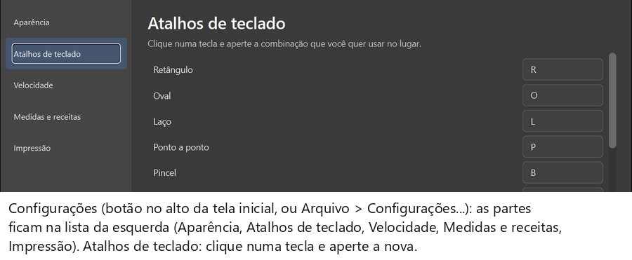

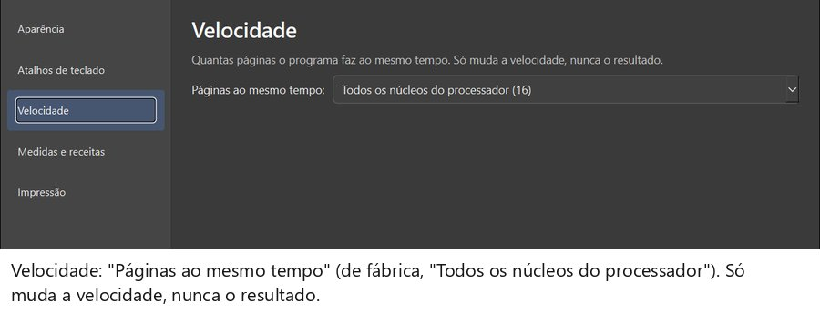

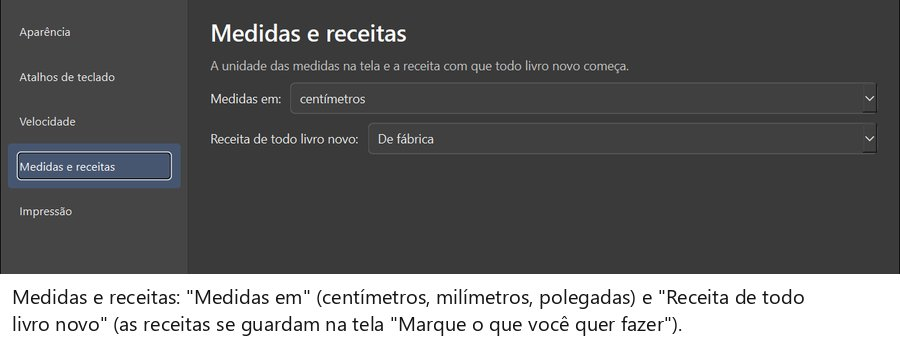

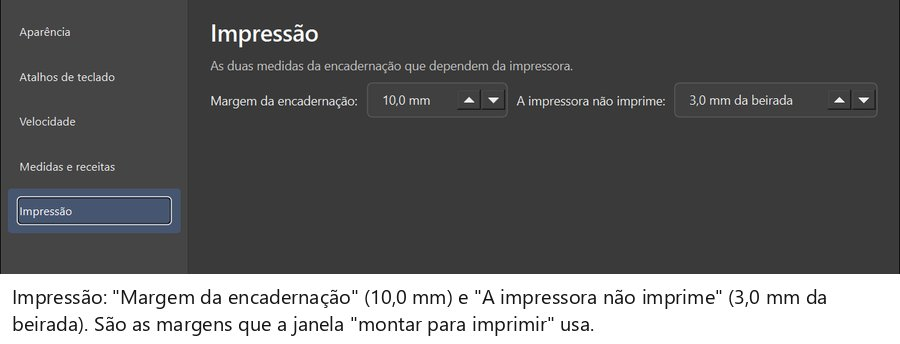

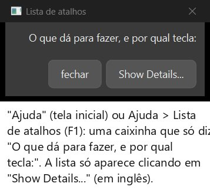

### Onde ficou a Luz

Painel **"Filtro da página"** (4º ícone da coluna da direita, desenho de meia lua) → parte **"Mais ajustes"** (abre
clicando na seta) → última linha: **"Igualar a luz da página"**, **"Suavizar as letras"** e **"Tirar o chuvisco"** (número de 0 a 100); o balão do mouse explica cada um. Só existe
em página com **Preto e branco, Melhorar ou Mágico pro**; no Original não há "Mais ajustes". "Suavizar" só no Preto e
branco.

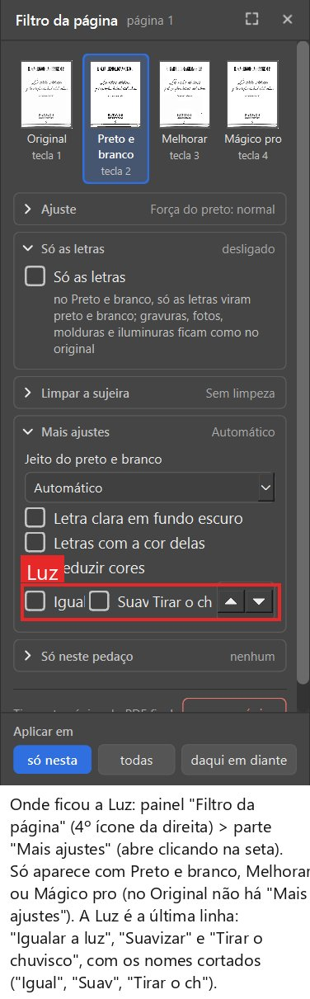

### Onde ficou a "Área"

Escolher uma ferramenta de marcar na coluna da esquerda (ex.: Retângulo, 4º ícone) → painel **"Propriedades"** (3º
ícone da direita) → rolar até o fim, depois de "Marcar como", "Marcação desta página" e "Foto" → **"Área"**:
"Mostrar as áreas achadas" e os botões da área escolhida (com a ferramenta "Mover e mudar o tamanho da área", tecla A).

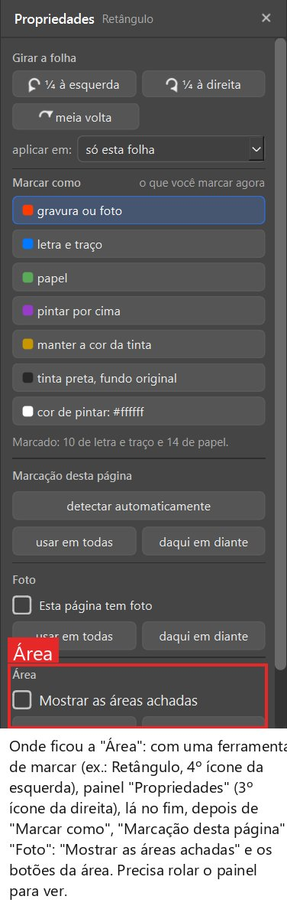

**Pontos confusos — Configurações, Luz e Área**

- **A "Ajuda" não mostra a lista**: a caixa diz só "O que dá para fazer, e por qual tecla:" e a lista fica escondida
  atrás de um botão em inglês, **"Show Details..."**.
- **Os nomes da Luz aparecem cortados** no painel: "Igual", "Suav", "Tirar o ch".
- A Luz some no filtro Original (o de fábrica): quem procura não acha.
- A "Área" fica no fim do painel Propriedades e só com ferramenta de marcar; precisa rolar.
- "Receita de todo livro novo" nas Configurações e a fila "Receita" na tela das caixinhas são a mesma coisa em dois
  lugares.

---

## Lista dos pontos confusos (todos juntos)

1. Não existe "rodar o automático": "Rodar o automático..." só abre a tela das caixinhas, e o painel "Automático" só
   mostra as etapas (achado 0-6).
2. Mudar as caixinhas de um livro já conferido e clicar "Conferir" não vale (defeito de 29/09, ainda aberto).
3. Caixinha marcada = tique sem quadrado; fácil desmarcar "Limpar a folha" sem querer — e aí somem as ferramentas de
   marcar, o Zoom, a Mão e os filtros (achado 0-4).
4. "Limpar a folha" vem marcada com o Original, que não limpa nada.
5. Fila "Receita" no topo, sem explicação (achado 0-1).
6. "Escurecer sozinho a força do preto..." marcada e cinza (achado 0-2).
7. "está certo" sem resposta visível (achado 0-3); só a barra de espaço avança.
8. Rodapé conta páginas enquanto o Dividir confere folhas; "está certo"/espaço no Dividir não mudam a contagem.
9. Três números de dúvidas diferentes (56 / 67-69 / 0).
10. Folha x página misturadas (FOLHAS/PÁGINAS, 180/360, "360 páginas" e "página 1 de 180" no livro aberto).
11. Coluna da esquerda sem nomes (só no balão do mouse); painéis da direita fechados e sem aviso.
12. "Os quatro filtros" (esquerda) e "Filtro da página" (direita) com o mesmo desenho.
13. Esc não fecha o "ver todas".
14. Tab não andou no teste (a conferir com o Samuel).
15. "imprimir agora" manda o livro inteiro para a impressora sem perguntar.
16. Dois "montar cadernos" com nomes parecidos.
17. Ajuda com "Show Details..." em inglês e a lista escondida; atalhos escritos "Ctrl+Return", "Ctrl+Left".
18. Nomes da Luz cortados; a Luz some no Original; a "Área" escondida no fim de Propriedades.
19. Menus Editar/Marcar/Filtro/Página/Painéis cinza na tela das caixinhas.
20. Nomes com "ScanTailor" e "Editor" nas listas (Jeito de dividir, Conta do endireitar).
21. Quadradinhos do painel Filtro vazios na primeira abertura; "Preparando a prévia..." no Endireitar.
22. Processar sem tempo estimado (11 min neste livro); PDF Original grande (287 MB).

---

## Onde estão as coisas

- Este mapa: `relatorios/testes-guiados/mapa-do-programa/mapa.md` (e `.html`, `.pdf`).
- Prints recortados e legendados (no git): `relatorios/testes-guiados/mapa-do-programa/prints/`.
- Prints inteiros e os textos tirados da janela (fora do git):
  `D:\programas\EditorImpressao-arquivos\mapa-do-programa-prints\brutos\` (`textos-p1.txt` a `textos-p5.txt` têm cada
  botão, caixinha e balão com a posição na janela).
- Roteiros que pilotaram a janela: `relatorios/testes-guiados/mapa-do-programa/roteiros/` (`p1` a `p5`,
  `p1b_icones_da_esquerda.py` para o achado 0-4, `montar_prints.py` para os recortes).
- Nenhuma linha do programa mudou.
