# Verificador clicando: os três consertos de 03/11 (D-602, D-004 no Gradus, D-590)

**Opinião: PRONTO PARA CONFERIR, com ressalvas.** Os três consertos funcionaram na janela de verdade.
Nada travou e nada ficou "uma folha na outra". Há três coisas que só o Samuel pode decidir (no fim).

**Como foi conferido: por olho, clicando.** O programa de verdade (a janela do Windows, com as letras de
verdade) foi aberto fora da tela. Os cliques foram mandados como mensagens de mouse do Windows direto para
a janela: botões, caixinhas, a lista "motor de corte" (abrir e escolher a opção), as miniaturas da tira, a
trilha de ferramentas, a pergunta "Páginas mexidas à mão". O Ctrl+Z foi tecla do Windows. Cada print foi
aberto e olhado. Pasta de dados isolada, só minha (nunca a do Samuel). O PDF do Gradus foi copiado para essa
pasta. Janela do tamanho da dele (1536 x 824, como nos prints a-51/a-53). O programa foi fechado no fim.

O que não foi clique de mão: o PDF foi aberto passando o caminho ao programa (sem a janela "Abrir" do
Windows). Para achar uma folha longe na tira, a tira foi rolada pelo programa, e o clique na miniatura foi
de mouse. A roda do mouse não foi usada.

Versão testada: `613d6833` (ponta do `obra-2026-10-26`).

---

## Teste 1: a linha azul e o Dividir (D-602) — funciona, com ressalvas

Palavras do Samuel (D-602): "Quando eu estiver na ferramenta de dividir, o programa deveria carregar com a
conta que está escolhida, e dai eu conseguir ver a linha e dai eu clicar e dividir esta, dai ele reparte [...]
o botão do jeito [...] o nome poderia ser motor de corte) ficou travado e não dava para mudar."

| O que fiz | O que vi | Resultado |
|---|---|---|
| Gradus aberto novo (70 folhas, nada dividido), cliquei no Dividir na trilha, cliquei na folha 5 | Linha azul tracejada na lombada, sem a pega "arraste". Nada cortado (70 páginas) | funciona |
| "Duas lado a lado" na folha 5 | A mesma linha, no mesmo lugar | funciona |
| "dividir esta" | Cortou exatamente na linha mostrada. Em "Uma página" aparece só a metade esquerda (página 2 do livro) | funciona |
| Troquei o "motor de corte" 15 vezes (folha dividida, folha inteira, em "Uma página" e "Duas lado a lado", depois de "não dividir esta", depois de "juntar todas", depois de trocar de folha) | A lista abriu e trocou nas 15 vezes. Nunca ficou cinza nem travada. Na folha inteira a linha muda com o motor (folha 6: Editor 0,491, ScanTailor 0,496) | funciona, com ressalva 1 |
| "dividir todas", e "parar" quando ia em 6 de 65 | Janela "Lendo as folhas pelo motor de corte... 6 de 65" com "parar". Depois de parar: nada mudou (70 páginas, 0 divididas) | funciona |
| "dividir todas" de novo, até o fim | 36 segundos. **140 páginas**, 70 folhas divididas. Cada folha cortada na sua própria linha (70 de 70 batem com a leitura do motor; 37 posições diferentes) | funciona |
| Olhei folhas 5, 9, 30 e 60 em "Duas lado a lado" | Linha na lombada de cada uma | funciona |
| Ctrl+Z | Voltou a 70 páginas, nenhuma dividida | funciona |
| Boécio (só folhas de uma página), folhas 1 e 3 | Sem linha, em "Uma página" e em "Duas lado a lado" | funciona |
| Procurei "jeito" em todos os textos do Dividir e da etapa 1 do Automático | Não aparece. No Automático está "Motor de corte:" e "motor de corte: o do ScanTailor" | funciona |

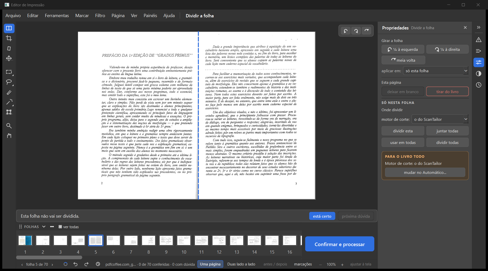

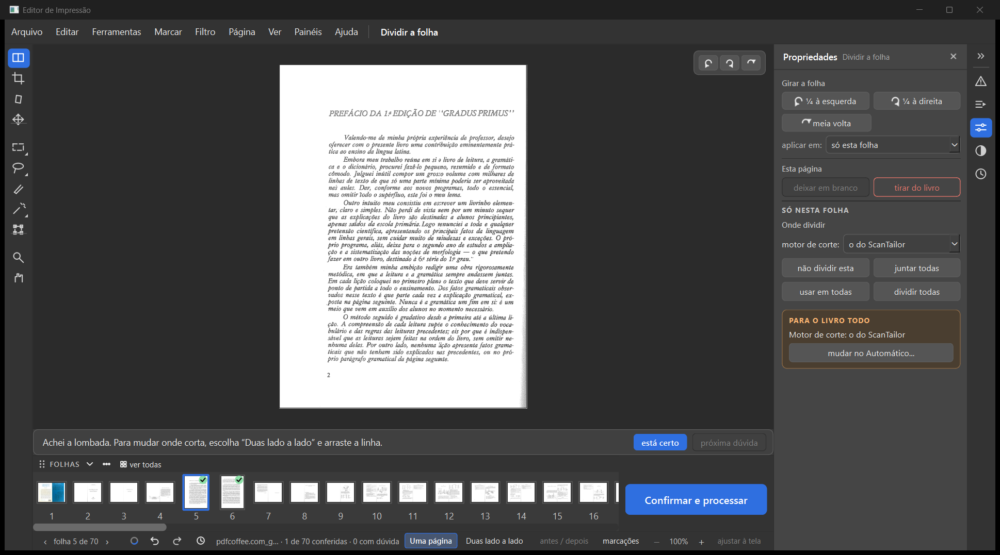

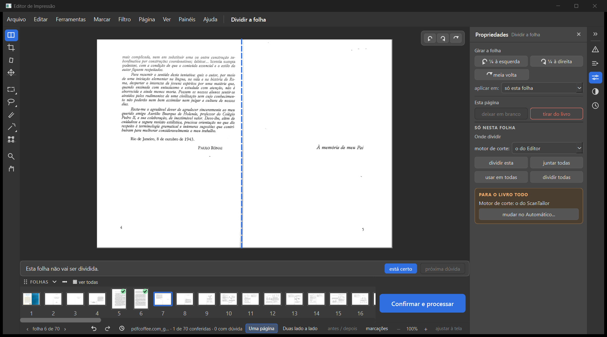

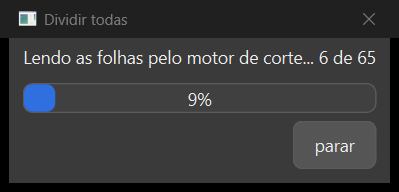

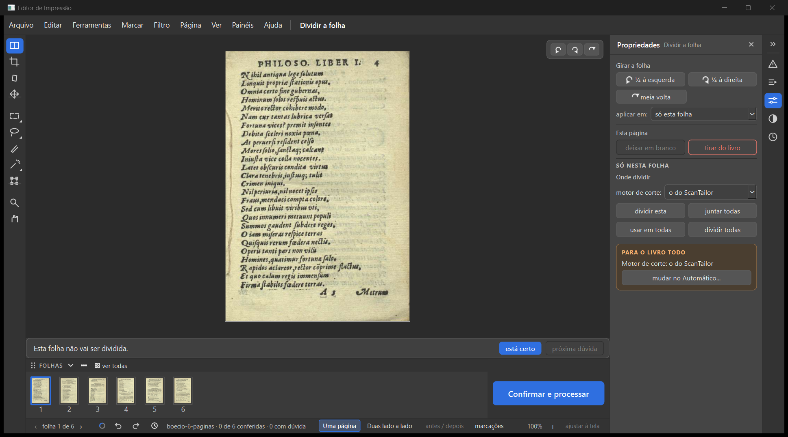

**Ressalvas do teste 1**

1. **Folha que já foi dividida e depois juntada**: trocar o motor não muda a linha. Exemplo: folha 5 depois
   de "não dividir esta", e folha 7 depois de "juntar todas". A linha fica onde estava antes, nos dois
   motores. Isso segue a D-498 ("dividir esta de novo devolve as duas como estavam, na linha de antes"). Mas
   quem olha vê a lista trocar e a linha parada. (Pergunta 1.)
2. **Frase de baixo**: na folha inteira com a linha azul à vista, a faixa diz "Esta folha não vai ser
   dividida." (print t1-03). Ela está certa (ainda não foi cortada), mas parece contradizer a linha. É a
   mesma frase do print a-50 do Samuel.
3. Depois do "dividir todas" o contador passou de "0 com dúvida" para "7 com dúvida", e o triângulo de
   avisos ficou com 7. Não investiguei quais são.
4. Depois do Ctrl+Z a tira voltou para o começo (folhas 1 a 16), mas a folha da vez era a 60: a miniatura
   escolhida ficou fora da vista (print t1-22).
5. Depois de usar a lista "motor de corte", a seta do teclado (→) não trocou de folha. O teclado ficou com a
   lista. O clique na seta da barra de baixo não foi testado.
6. A palavra "jeito" continua na etapa 4 do Automático ("Jeito de limpar", "Jeito do preto e branco") e no
   balão da receita. Isso está fora do Dividir. A D-602 fala só do Dividir e da etapa 1.

---

## Teste 2: Automático depois de dividir à mão (defeito do Gradus, D-004) — funciona, com ressalvas

Palavras do Samuel: "teve até uma folha que ficou colocada uma na outra" · D-004: "o programa pergunta se
quer pular as páginas mexidas."

| O que fiz | O que vi | Resultado |
|---|---|---|
| Gradus novo. Dividir: "dividir esta" nas folhas 1, 2 e 9 | 73 páginas | funciona |
| "Rodar o automático…" (o botão do aviso "Livro novo"). Desmarquei tudo e deixei só "1 Dividir folhas ao meio", "no livro todo" | A frase diz "Vou dividir as folhas, no livro todo (73 páginas)." | funciona |
| Rodar | A pergunta "6 páginas foram mexidas à mão [...] Pular essas páginas?" Cliquei "Pular as 6" | funciona |
| Depois de rodar (72 s) | **140 páginas**, 70 folhas divididas. Toda folha tem 2 páginas, nenhuma metade repetida | funciona |
| Olhei as folhas 5 a 10, metade por metade, em "Uma página", e cada folha em "Duas lado a lado" (18 prints) | Cada página é a metade certa, na ordem do livro (páginas 2, 3, 4, 5, branca, 7, branca, 9, 10, 11, 12, 13). **Nenhuma "uma na outra"**. A folha 9, dividida à mão, ficou com a linha dela | funciona |
| Marquei "6 Margens iguais" (com o Dividir), e olhei a prévia na página 11 (como no a-51) e na 5 | Página em pé, uma só, com a margem branca em volta. **Nenhuma folha deitada** | funciona |
| Rodar com Dividir e Margens ("Pular as 6") | 140 páginas, todas em pé. Olhei as páginas 1, 3, 9, 11, 12, 13, 17, 18, 20 e 60, e as 12 e 18 em "Duas lado a lado". **Nenhuma deitada nem misturada** (no a-53 as 11 e 12 estavam deitadas) | funciona |

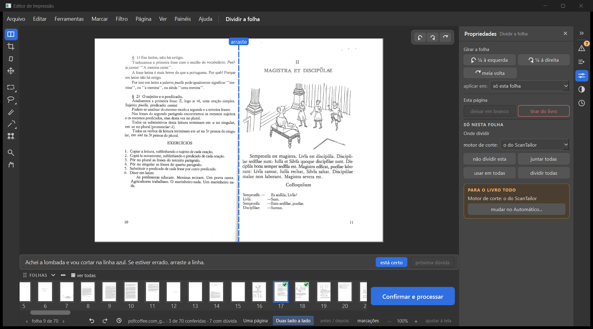

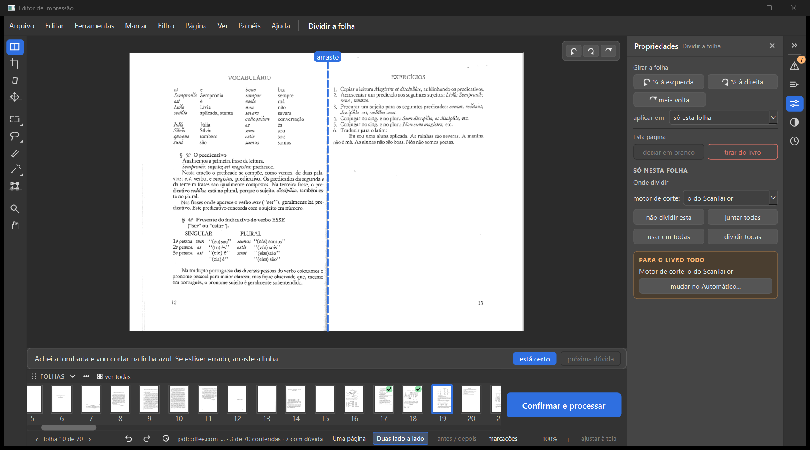

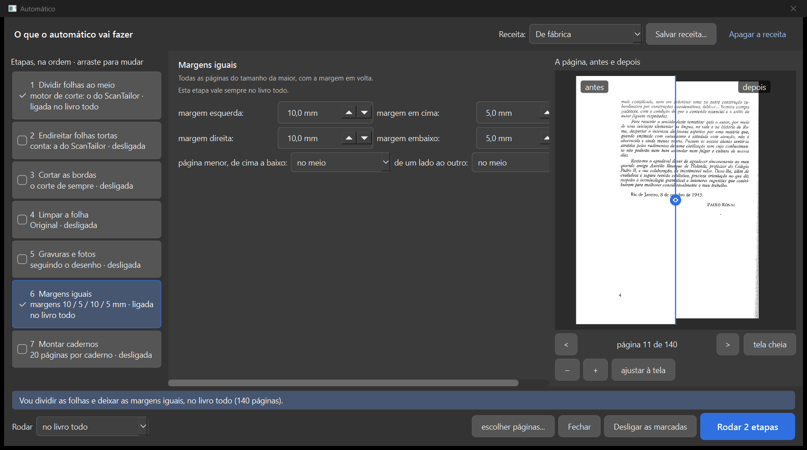

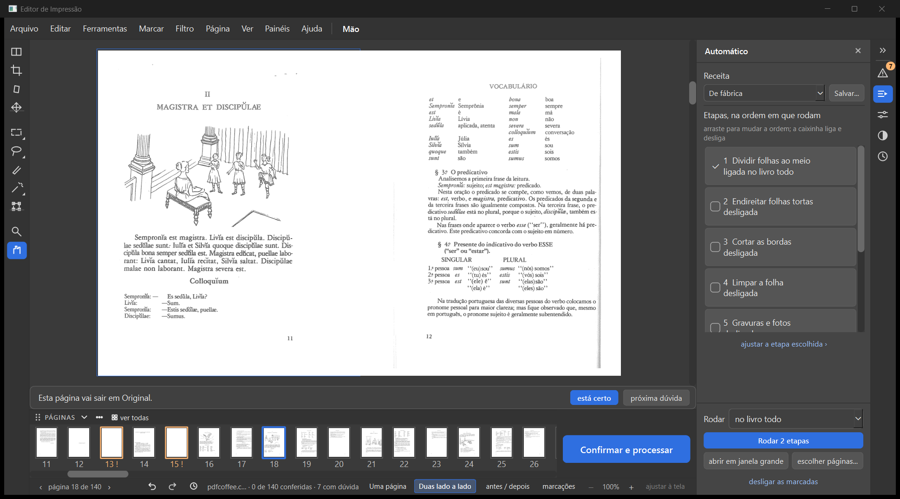

**Ressalvas do teste 2**

1. **A rodada foi parada no meio** (o Samuel pediu) logo depois de marcar "Margens iguais". Retomei
   reabrindo o trabalho pela tela inicial. A rodada parada já tinha ficado gravada (Margens "ligada no livro
   todo", 140 páginas). Rodei de novo Dividir + Margens, e a pergunta voltou ("Pular as 6").
2. **O PDF final não foi gerado nem medido** (não foi pedido). A vista da página na área de trabalho não
   mostra a margem acrescentada: quem mostra é a prévia do Automático. Não sei se as 6 páginas puladas
   (folhas 1, 2 e 9) recebem as margens iguais no PDF. A pergunta diz "pular nessas etapas", e as etapas
   eram Dividir e Margens. (Pergunta 2.)
3. Na janela grande do Automático, na etapa 6, a coluna do meio fica cortada à direita nesse tamanho de
   janela: "5,0 mm" e "no meio" aparecem pela metade, com barra de rolagem (print t2m-02). O print a-51 do
   Samuel mostra a mesma coluna cortada do outro lado.
4. Minha primeira tentativa travou na pergunta das mexidas. O defeito era do meu roteiro (o "respondedor"
   de janelas sumiu da memória), não do programa. A pergunta estava na tela, certa
   (`t2-primeira-tentativa/`).

---

## Teste 3: a caixinha do Dividir (D-590) — funciona, com ressalva

Palavras do Samuel (03/11): "Sim a caixinha continua desmacada."

| O que fiz | O que vi | Resultado |
|---|---|---|
| Livro do teste 2 (140 páginas, Dividir e Margens ligadas). Na janela grande, desmarquei "1 Dividir" e deixei "6 Margens" para ter o que rodar | Frase: "Vou deixar as margens iguais, no livro todo (140 páginas)." **Não diz "Vou dividir"** | funciona |
| Rodar | Continua com **140 páginas, 70 folhas divididas** | funciona |
| Painel Automático | "1 Dividir folhas ao meio · desligada", caixinha **desmarcada** | funciona |
| Janela grande reaberta | Caixinha **desmarcada**, "desligada". A frase só fala de margens | funciona |
| Fechei o programa e abri de novo (programa novo, mesma pasta de dados). Abri o livro pela tela inicial | 140 páginas. Painel e janela grande: Dividir **desmarcada** | funciona |
| "juntar todas" (70 páginas). Marquei "1 Dividir" de novo e Rodar | Pergunta: "**70 páginas foram mexidas à mão** [...] Pular essas páginas?". Com "Pular as 70", **nada foi dividido**: continuou com 70 páginas, mas a caixinha ficou marcada, "ligada no livro todo" | ressalva (pergunta 3) |
| De novo: Dividir marcada, Rodar, e "Rodar nelas também" | **140 páginas**, 70 divididas. Caixinha marcada no painel e na janela grande, "ligada no livro todo" | funciona |

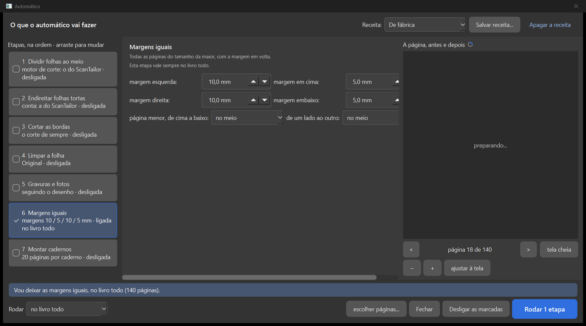

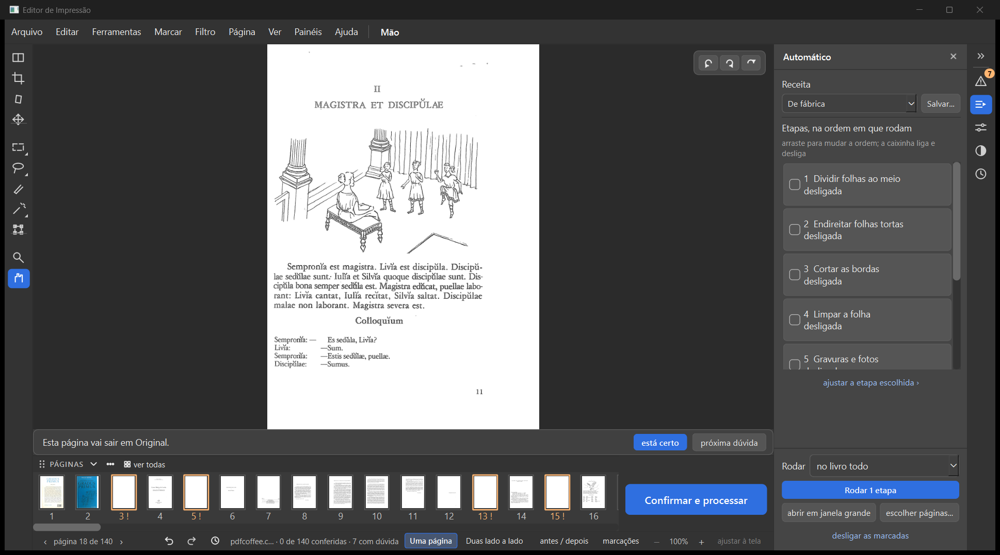

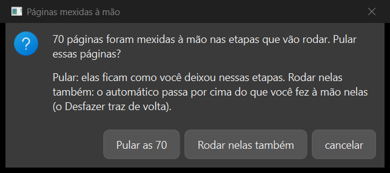

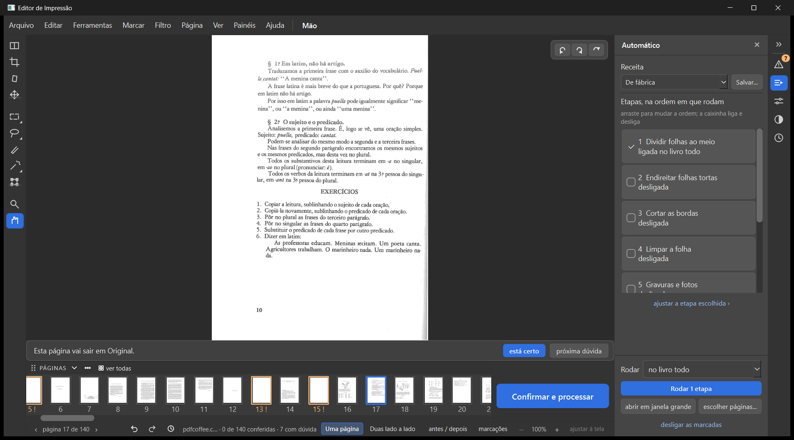

**Ressalva do teste 3**: depois de "juntar todas", as 70 folhas contam como "mexidas à mão". Ao marcar
Dividir e rodar, o programa pergunta. "Pular" deixa tudo inteiro, mas a etapa aparece "ligada no livro
todo". O teste do pedido ("marcar de novo e rodar → divide") só deu certo com "Rodar nelas também".
(Pergunta 3.) O "juntar todas" também marcou as 70 folhas como conferidas ("70 de 70 conferidas", tique
verde em todas as miniaturas; print t3b-05).

---

## Como cumpri cada decisão

| Decisão | Situação | Prova |
|---|---|---|
| D-602 linha azul antes de cortar, só na folha dupla | cumprida | t1-03, t1-04, boecio-01 a 03 |
| D-602 "dividir esta" corta na linha | cumprida | t1-05 (0,5086 mostrada = 0,5086 cortada) |
| D-602 "dividir todas" | cumprida | t1-14, t1-16, t1-17, t1-18 a 21; 140 páginas |
| D-602 "motor de corte" no lugar de "jeito" | cumprida no Dividir e na etapa 1 | t1-23; ressalva 6 |
| D-602 lista travada | cumprida (15 de 15 trocas) | anotacoes-t1, troca-01 a 15 |
| D-601 "Uma página" mostra a metade | cumprida | t1-05, t2-04 a t2-15 |
| D-498 / D-590 "não dividir esta", "juntar todas", Ctrl+Z | cumprida | t1-11, t1-12, t1-22 |
| D-004 pergunta e pular, sem "uma na outra" | cumprida | por-cima/t2-por-cima-01, t2-16 a t2-21 |
| D-590 caixinha desmarcada fica desmarcada, folhas continuam divididas | cumprida (também ao reabrir) | t3-02 a t3-04, t3b-02, t3b-03 |
| D-090 "usar em todas" | não testado (não foi pedido) | — |

## Perguntas para o Samuel

1. Folha que você dividiu e depois juntou: ao trocar o "motor de corte", a linha deve ir para onde o motor
   novo acha? Hoje ela fica na linha de antes (regra D-498, "na linha de antes").
2. "Pular as 6" com Margens iguais marcada: as páginas mexidas à mão também devem ficar sem as margens
   iguais? Ou "pular" vale só para o que foi mexido (o Dividir)? Não medi o PDF.
3. Depois de "juntar todas", marcar Dividir e rodar pergunta "70 páginas mexidas à mão". Responder "Pular"
   não divide nada, e a etapa fica "ligada no livro todo". É isso que você quer, ou "juntar todas" não deve
   contar como mexida à mão para o Automático?

## Onde estão as coisas

- Prints numerados nesta pasta: `t1-*`, `boecio-*`, `t2-*`, `t2m-*`, `t3-*`, `t3b-*`, `t3c-*`. As janelas
  que abriram por cima estão em `por-cima/`.
- Anotações de cada passo (estado da linha, contagem de páginas, caixinhas): `anotacoes-*.txt` e `.json`.
- O roteiro que pilotou a janela: `piloto.py`.
- Pasta de dados isolada:
  `C:\Users\fotog\AppData\Local\Temp\claude\C--Users-fotog\05fa28dc-c2f5-4152-b355-e6ab76bb386f\scratchpad\verif-03-11-dados\`.
  Ninguém mais usa essa pasta. Não apaguei (fica fora do projeto).
